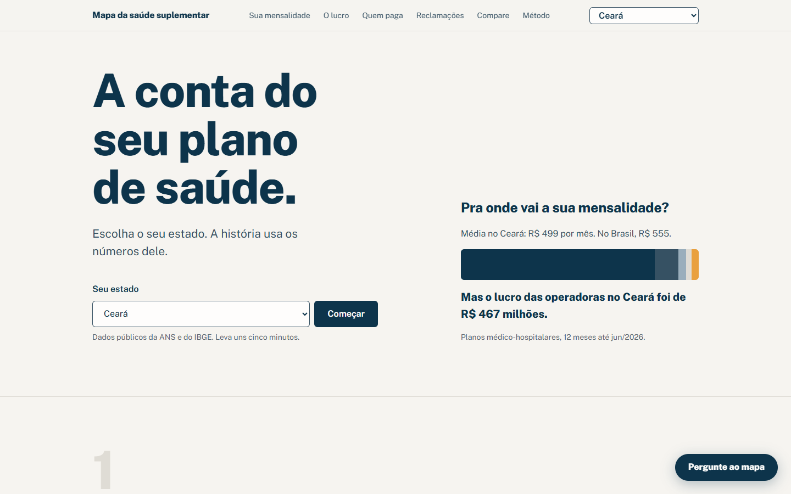
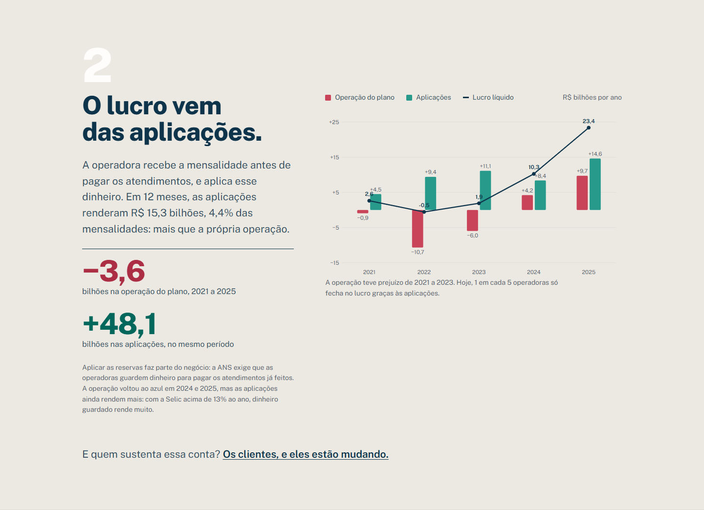
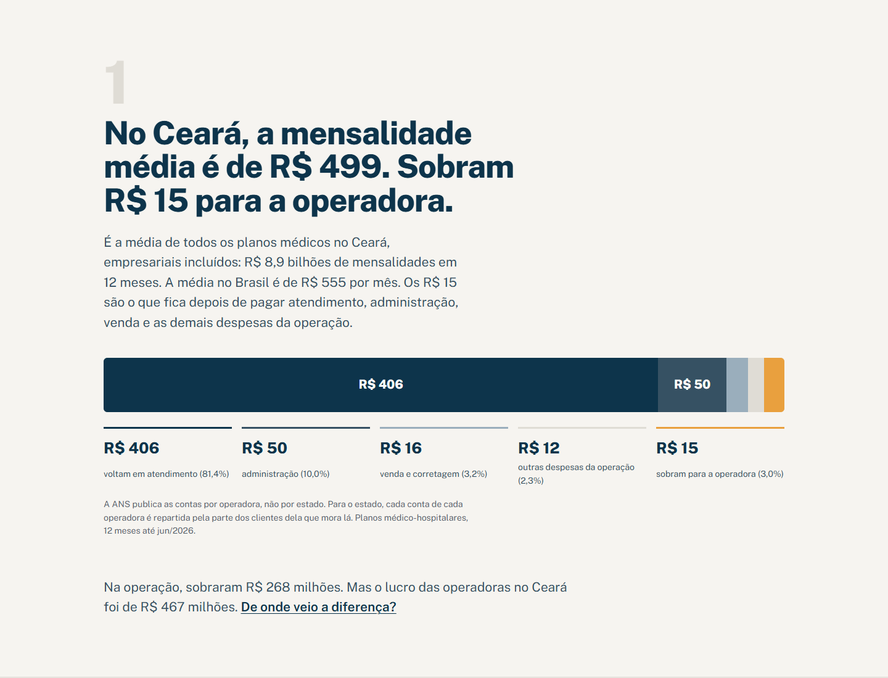
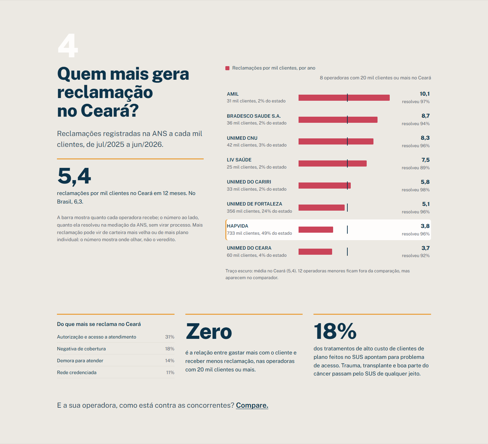
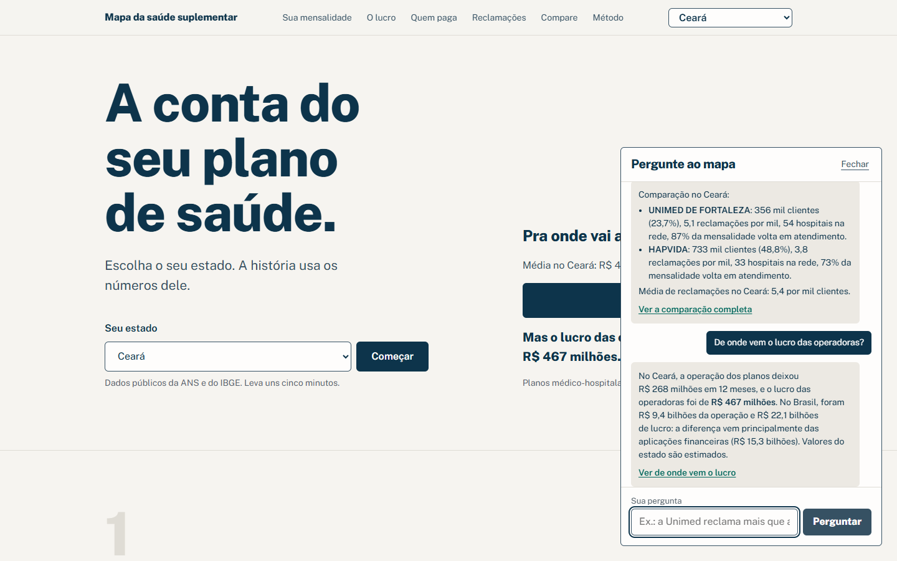
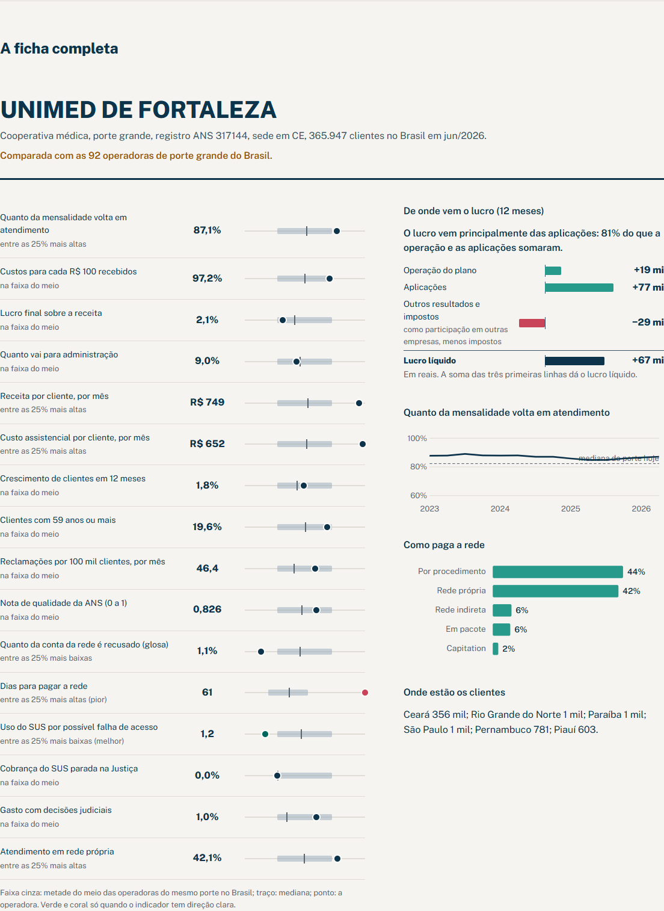
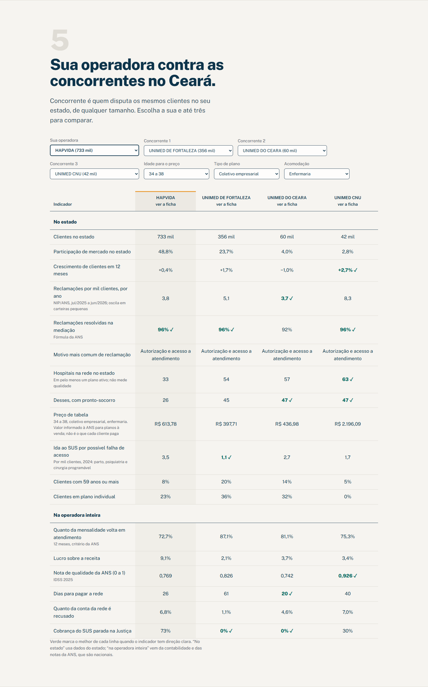

# Mapa da saúde suplementar

**Os dados públicos da ANS sobre planos de saúde, organizados para ler.**
Quanto da mensalidade volta em atendimento, de onde vem o lucro, quem mais gera reclamação no seu estado e como a sua operadora se compara às concorrentes: as 682 operadoras médicas ativas, com dados abertos da ANS e do IBGE.

**[Abrir o site](https://mapa.feliperodrigues.cloud/)** · abre no celular, sem login · [ficha da operadora, exemplo](https://mapa.feliperodrigues.cloud/#operadora/326305) · cópia no [GitHub Pages](https://felipe-rodrigues-gomes.github.io/mapa-saude-suplementar/) · [English summary](#english-summary)



## Em 30 segundos

- **O que é:** um site público que explica o mercado de planos de saúde com os dados abertos da ANS, do jeito que um leigo entende, e um assistente que responde perguntas em português.
- **Volume:** cerca de 8 GB de beneficiários, 5,6 GB de ressarcimento ao SUS, 2,1 GB de rede hospitalar (26 GB descompactados) e 22 trimestres contábeis, tratados em Python até virar 3 MB de dados para o site.
- **Validação:** os indicadores batem com os painéis oficiais da ANS (sinistralidade de 2024 a 2026 com diferença de até 0,1 p.p.; lucro do setor igual ao da ANS, em bilhões com uma casa). [Tabela de conferência](#os-números-conferem-com-a-ans).
- **Qualidade de dado:** [9 problemas encontrados nas bases da ANS](#problemas-encontrados-nos-dados-da-ans), documentados e contornados, como uma base de resolução de reclamações parada em 2019.
- **Ferramentas:** Python (pandas, pyarrow), Power BI (projeto PBIP com modelo em TMDL e 37 medidas DAX), HTML, CSS e JavaScript sem framework com gráficos em SVG à mão, Node com um modelo de IA gratuito, Docker e nginx.
- **Decisões que defendo:** a IA do assistente não escreve número, só entende a pergunta; as estimativas por estado somam exatamente o total do Brasil; o ranking de reclamações só entra com carteira de 20 mil clientes ou mais.

## O achado

De 2021 a 2025, a operação dos planos médicos (mensalidades menos atendimento, administração e venda) **perdeu R$ 3,6 bilhões**. No mesmo período, as aplicações financeiras **renderam R$ 48,1 bilhões**. Todo o lucro do setor, R$ 37,6 bilhões, veio daí.

| Ano | Operação do plano | Aplicações | Lucro líquido |
|---|---:|---:|---:|
| 2021 | −0,9 | +4,5 | 2,6 |
| 2022 | −10,7 | +9,4 | −0,5 |
| 2023 | −6,0 | +11,1 | 1,9 |
| 2024 | +4,2 | +8,4 | 10,3 |
| 2025 | +9,7 | +14,6 | 23,4 |

R$ bilhões, operadoras médico-hospitalares. Aplicar as reservas faz parte do negócio: a ANS exige que as operadoras guardem dinheiro para pagar atendimentos já feitos. O quadro mudou em 2024 e 2025, quando a operação voltou ao azul (+R$ 4,2 bi e +R$ 9,7 bi), mas as aplicações seguem rendendo mais, com a Selic acima de 13% ao ano. Hoje, **1 em cada 5 operadoras** só fecha no lucro por causa das aplicações.



## O que tem no site

O leitor escolhe o estado logo na abertura e a página inteira passa a falar dele, em cinco capítulos curtos:

1. **Sua mensalidade:** a mensalidade média do estado escolhido e quanto dela vai para atendimento, administração, venda e outras despesas, e quanto sobra. No Brasil, R$ 555 por mês: 81,8% voltam em atendimento e 2,7% sobram da operação; mesmo assim, o lucro das operadoras foi de R$ 22,1 bilhões em 12 meses. No Ceará, R$ 499, e um lucro estimado em R$ 467 milhões com os clientes do estado.
2. **O lucro:** operação × aplicações × lucro, ano a ano.
3. **Quem paga:** cobertura por estado e por município (clientes ÷ população do IBGE), participação de mercado das maiores operadoras do estado e a queda do plano individual.
4. **Reclamações:** reclamações na ANS a cada mil clientes, por operadora, no estado do leitor, contra a média do estado; quanto cada uma resolveu na mediação e do que mais se reclama.
5. **Compare:** a sua operadora contra até três concorrentes do mesmo estado, de qualquer porte: clientes, reclamações, hospitais na rede, preço de tabela, ida ao SUS, sinistralidade, nota da ANS, prazo de pagamento à rede. Abre a ficha completa, com 16 indicadores comparados às operadoras do mesmo porte e de onde vem o lucro: operação do plano, aplicações e outros resultados, com uma frase que diz qual pesou mais.

**Pergunte ao mapa:** um botão flutuante responde perguntas em português ("a Unimed Fortaleza reclama mais que a Hapvida?", "quanto custa um plano para 40 anos?"). A IA, um modelo gratuito, só entende a pergunta; os números saem dos mesmos dados das telas, com link para elas. A IA não escreve número nenhum, então a resposta e a tela nunca discordam. Sem a IA, uma leitura por palavras-chave responde as perguntas mais comuns. Método em [docs/09_assistente.md](docs/09_assistente.md).

Cada tela tem link próprio, para mandar no WhatsApp: `#reclamacoes/CE`, `#compare/CE/317144,368253`, `#operadora/317144`.

| Sua mensalidade (Ceará) | Reclamações por mil clientes |
|---|---|
|  |  |
| **Pergunte ao mapa** | **Ficha da operadora** |
|  |  |

<details><summary>Comparador completo (imagem longa)</summary>



</details>

## Os números conferem com a ANS

| Indicador | Este projeto | ANS |
|---|---:|---:|
| Sinistralidade 2024 | 83,7% | 83,8% |
| Sinistralidade 2025 | 81,8% | 81,7% |
| Sinistralidade 1º sem. 2026 | 81,9% | 81,9% |
| Resultado da operação 2022 | −R$ 10,7 bi | −R$ 10,7 bi |
| Lucro líquido 2025 | R$ 23,4 bi | R$ 23,4 bi |
| Lucro líquido 1º sem. 2026 | R$ 10,9 bi | R$ 10,9 bi |

A fórmula da sinistralidade foi encontrada testando variantes contra os números oficiais e depois confirmada na nota metodológica do Painel Econômico-Financeiro da ANS:

```
Sinistralidade = (Eventos indenizáveis líquidos + |Corresponsabilidade cedida|)
               ÷ (Contraprestações efetivas + |Corresponsabilidade cedida|)
```

## Problemas encontrados nos dados da ANS

1. **A base aberta de taxa de cobertura veio com a população zerada** (soma de 604 mil pessoas para o Brasil) e municípios de Tocantins classificados em Goiás. Substituída pelas estimativas do IBGE.
2. **Acentos corrompidos na origem** em parte dos arquivos de beneficiários ("M�dico-hospitalar") e outros em UTF-8 lido como latin-1: 1,5 milhão de vidas ficariam sem cobertura identificada.
3. **Desde 2024, operadoras com até 20 mil beneficiários só entregam o balanço do 4º trimestre.** Aqui, os trimestres que faltam ficam vazios, não estimados.
4. **Quebra de série em 2022 nos planos pós-estabelecidos:** a receita passou a ser só a taxa de administração. Receita de 2021 não se compara com a de 2022.
5. **Ressarcimento ao SUS:** as cobranças de acompanhamento pós-transplante praticamente somem a partir de 2024 (de ~45 mil para ~1,9 mil por ano).
6. **Glosa improvável:** 15% das operadoras informam glosa abaixo de 0,05%, e uma das maiores informou 99%. Ficam marcadas e fora das comparações de glosa.
7. **O dicionário do IGR descreve errado** o denominador do índice (diz "beneficiários que reclamaram"; é a carteira inteira).
8. **A base aberta de taxa de resolutividade parou em out/2019.** Aqui, a resolução é recalculada a partir das reclamações (NIP) com a fórmula da ficha técnica da ANS; o total de reclamações bate com o IGR (correlação 1,0 por operadora).
9. **O arquivo da rede hospitalar usa compressão deflate64** (2,1 GB, 26 GB descompactado), que bibliotecas comuns não abrem; é lido pelo `unzip`, um estado por vez.

## Como foi feito

| Etapa | Arquivo | O que faz |
|---|---|---|
| Fontes | [`docs/01_mapa_das_fontes.md`](docs/01_mapa_das_fontes.md) | onde está cada base, período e defasagem |
| Tratamento | [`docs/02_tratamento.md`](docs/02_tratamento.md) | modelo de dados, decisões e validação |
| Achados | [`docs/05_achados.md`](docs/05_achados.md) | nove achados conferidos e o que fica de fora |
| Power BI | [`docs/06_powerbi_plano.md`](docs/06_powerbi_plano.md) | modelo semântico e medidas |
| Site | [`docs/07_site.md`](docs/07_site.md) | estrutura e decisões técnicas |

**Fontes:** [dados abertos da ANS](https://dadosabertos.ans.gov.br/FTP/PDA/) (demonstrações contábeis/DIOPS, beneficiários/SIB, IGR, IDSS, painel de glosas, ressarcimento ao SUS, cadastro de operadoras) e população estimada do IBGE (SIDRA, tabela 6579). Nenhum dado de operadora que não seja público.

**Python** (pandas, pyarrow) baixa, trata e valida tudo: 20 meses de beneficiários (≈ 8 GB baixados e agregados sem guardar o bruto), 22 trimestres contábeis, 5,6 GB de ressarcimento ao SUS.

**Power BI** ([`powerbi/`](powerbi/)): projeto PBIP com o modelo semântico em TMDL, legível aqui no GitHub: 8 tabelas, 37 medidas comentadas, duas páginas (o achado e a ficha). A ficha usa uma tabela de indicadores desconectada com `SWITCH` e `PERCENTILEX.INC` para comparar qualquer operadora com os quartis do seu porte, com formato dinâmico por indicador. Exemplo, como se digita no Power BI em português:

```dax
Sinistralidade (12 meses) =
DIVIDE ( SUM ( fContabil[sinist_num_12m] ); SUM ( fContabil[sinist_den_12m] ) )
```

**Site** ([`site/`](site/)): HTML, CSS e JavaScript sem framework e sem biblioteca de gráficos. Os gráficos são SVG desenhados à mão; o mapa é pré-projetado em Python a partir da malha do IBGE. A primeira tela carrega cerca de 100 KB de dados.

## Reproduzir

```bash
python -m venv .venv && .venv/Scripts/pip install -r requirements.txt
python -I scripts/etl_beneficiarios.py .      # ~45 min
python -I scripts/etl_benef_municipio.py .
python -I scripts/etl_contabil.py
python -I scripts/etl_qualidade.py
python -I scripts/etl_ressarcimento.py
python -I scripts/etl_ibge.py
python -I scripts/etl_cadastro.py
python -I scripts/validar.py                  # confere com a ANS
python -I scripts/indicadores.py
python -I scripts/etl_nip.py                  # reclamações por operadora e estado
python -I scripts/etl_preco_rede.py           # preço de tabela e hospitais na rede
python -I scripts/exportar_site.py            # site/dados
python -I scripts/exportar_uf.py              # site/dados/uf: um arquivo por estado
python -I scripts/exportar_cada_uf.py         # capítulo 1 por estado: mensalidade média, destino e lucro
python -I scripts/exportar_pbi.py && python -I scripts/gerar_pbip.py && python -I scripts/gerar_paginas.py
```

Os arquivos brutos e intermediários (`dados/brutos`, `dados/tratados`) não estão no repositório; os scripts baixam tudo de novo. Os dados já prontos para o site (`site/dados`) e para o Power BI (`dados/pbi`) estão incluídos. No Power BI, troque o parâmetro `PastaDados` para a sua pasta `dados/pbi`.

## Limites

- O assistente responde só o que o site mostra; perguntas sobre contrato, cobertura ou um caso pessoal são encaminhadas à operadora ou à ANS.
- A contabilidade é nacional por operadora: o filtro de estado mostra as operadoras com clientes no estado, não uma sinistralidade do estado.
- Mensalidade média, destino da mensalidade e lucro por estado são estimativas: cada conta de cada operadora é repartida entre os estados pela parte dos clientes de plano médico que ela tem em cada um. Uma operadora nacional leva para o estado a sua média nacional, o que pesa em estados pequenos (em Roraima, R$ 976). Somados, os 27 estados dão o total do Brasil.
- Uso do SUS mede só internações e tratamentos de alto custo identificados pela ANS; consulta, exame simples e pronto-socorro sem internação não aparecem.
- A ANS não informa grupo econômico: cada registro na ANS é uma operadora.
- Reclamações por mil clientes oscilam em carteiras pequenas: o ranking só mostra operadoras com 20 mil clientes ou mais no estado. Mais reclamação pode vir de carteira mais velha ou de mais plano individual; o número mostra onde olhar, não o veredito.
- Preço de tabela é o valor comercial médio informado à ANS para os planos à venda (mediana por operadora e estado), não o que cada cliente paga.
- Hospitais na rede contam estabelecimentos ligados a pelo menos um plano ativo da operadora no estado; não medem qualidade nem acesso efetivo.
- Dados atualizados em 16/11/2026: contabilidade e clientes até jun/2026, reclamações de jul/2025 a jun/2026, preço de tabela de jun/2026, IDSS 2025 (ano-base 2024), glosa até o 2º semestre de 2025.

## English summary

**Brazilian private health insurance, explained with open data.** A public website that turns the open data of ANS, Brazil's health insurance regulator, into a story anyone can read: where the monthly fee goes, where insurers' profits come from, who gets the most complaints in each state, and how any insurer compares with its local competitors.

- **Main finding:** from 2021 to 2025, the insurance operation itself lost R$ 3.6 billion, while financial income on reserves earned R$ 48.1 billion. Operations turned profitable again in 2024 and 2025, but with Brazil's policy rate above 13%, investments still earn more than the core business.
- **Data engineering:** about 8 GB of enrollment data, 5.6 GB of public-health reimbursement records, a 2.1 GB provider-network file (26 GB uncompressed) and 22 quarters of financial statements, processed in Python (pandas, pyarrow) and validated against ANS's official dashboards (loss ratio within 0.1 p.p. for 2024 to 2026). Nine data-quality problems in the official sources are documented and handled.
- **Front end:** plain HTML, CSS and JavaScript with hand-drawn SVG charts, mobile first, every screen personalized by the reader's state.
- **AI assistant:** a free LLM (Gemini) only classifies the question into a closed schema; every number in the answer comes from the same data as the charts, so the assistant cannot invent figures. It falls back to keyword parsing when the model is unavailable.
- **BI:** a Power BI project (PBIP/TMDL) with 37 documented DAX measures.

The site and documentation are in Portuguese. Built by [Felipe Rodrigues Gomes](https://www.linkedin.com/in/feliperodriguesgomes/), economist and BI analyst in Brazilian health insurance.

---

Projeto independente, sem vínculo com a ANS nem com qualquer operadora. Feito por **[Felipe Rodrigues Gomes](https://www.linkedin.com/in/feliperodriguesgomes/)**, economista e analista de BI em saúde suplementar. Código sob licença MIT; dados de fontes públicas, citadas acima.
