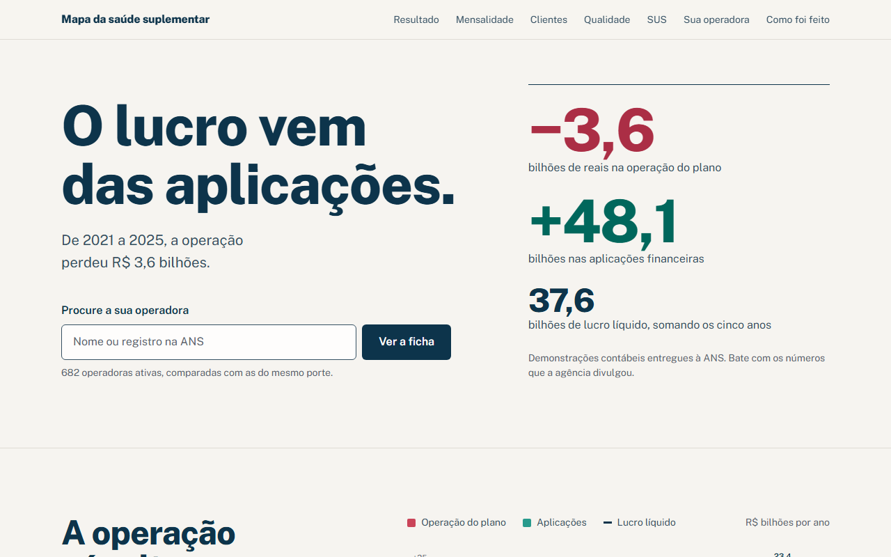
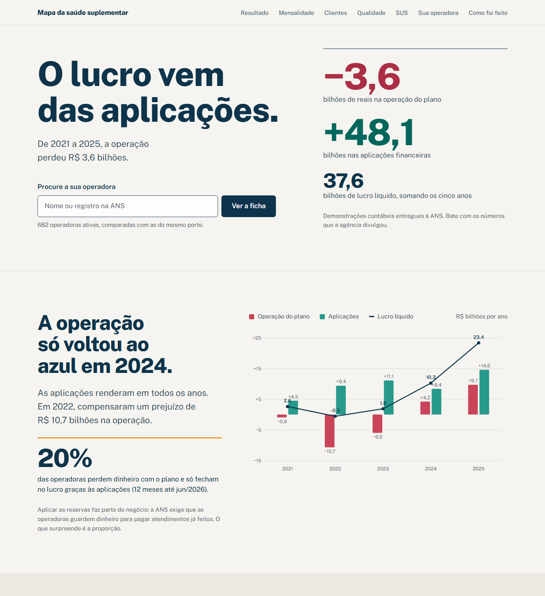
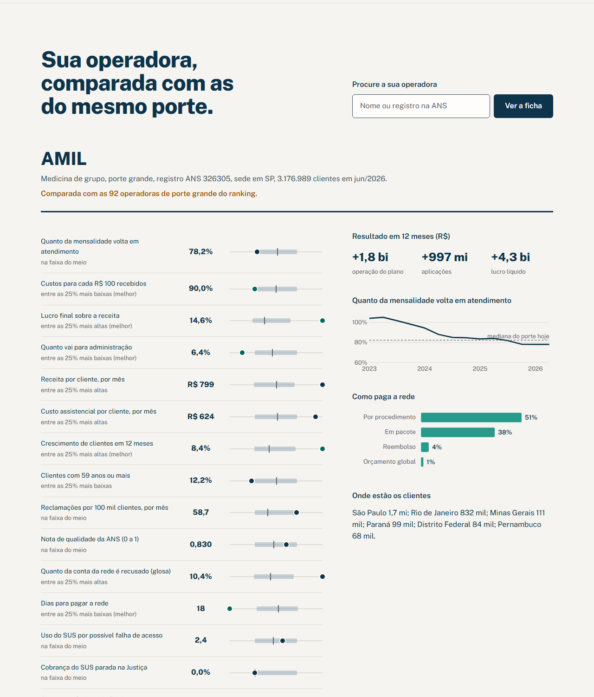

# Mapa da saúde suplementar

**Os dados públicos da ANS sobre planos de saúde, organizados para ler.**
Resultado, sinistralidade, clientes, qualidade, uso do SUS e a ficha de cada uma das 682 operadoras médicas ativas, comparada com as do mesmo porte.

**[Abrir o site](https://felipe-rodrigues-gomes.github.io/mapa-saude-suplementar/)** · abre no celular, sem login · [ficha da operadora, exemplo](https://felipe-rodrigues-gomes.github.io/mapa-saude-suplementar/#operadora/326305)



## O achado

De 2021 a 2025, a operação dos planos médicos (mensalidades menos atendimento, administração e venda) **perdeu R$ 3,6 bilhões**. No mesmo período, as aplicações financeiras **renderam R$ 48,1 bilhões**. Todo o lucro do setor, R$ 37,6 bilhões, veio daí.

| Ano | Operação do plano | Aplicações | Lucro líquido |
|---|---:|---:|---:|
| 2021 | −0,9 | +4,5 | 2,6 |
| 2022 | −10,7 | +9,4 | −0,5 |
| 2023 | −6,0 | +11,1 | 1,9 |
| 2024 | +4,2 | +8,4 | 10,3 |
| 2025 | +9,7 | +14,6 | 23,4 |

R$ bilhões, operadoras médico-hospitalares. Aplicar as reservas faz parte do negócio (a ANS exige que as operadoras guardem dinheiro para pagar atendimentos já feitos); o que surpreende é a proporção. Hoje, **1 em cada 5 operadoras** só fecha no lucro por causa das aplicações.



## O que tem no site

- **Resultado:** operação × aplicações × lucro, ano a ano.
- **Quanto da mensalidade volta em atendimento:** sinistralidade em 12 meses móveis, por modalidade, e ranking dentro do mesmo porte, filtrável por modalidade e estado.
- **Clientes:** cobertura por estado e por município (clientes ÷ população do IBGE), concentração do mercado e a queda do plano individual.
- **Custo × qualidade:** gastar mais com o cliente não reduz reclamação (correlação praticamente nula).
- **SUS:** quando o cliente de plano vai ao SUS, nem sempre é falha da operadora. Os atendimentos foram separados em três leituras (não indica falha, zona cinzenta, provável falha de acesso).
- **Ficha da operadora:** 16 indicadores, cada um com a faixa das operadoras do mesmo porte.



## Os números conferem com a ANS

| Indicador | Este projeto | ANS |
|---|---:|---:|
| Sinistralidade 2024 | 83,7% | 83,8% |
| Sinistralidade 2025 | 81,8% | 81,7% |
| Sinistralidade 1º sem. 2026 | 81,9% | 81,9% |
| Resultado da operação 2022 | −R$ 10,7 bi | −R$ 10,7 bi |
| Lucro líquido 2025 | R$ 23,4 bi | R$ 23,4 bi |
| Lucro líquido 1º sem. 2026 | R$ 10,9 bi | R$ 10,9 bi |

A fórmula da sinistralidade foi encontrada testando variantes contra os números oficiais e depois confirmada na nota metodológica do Painel Econômico-Financeiro da ANS:

```
Sinistralidade = (Eventos indenizáveis líquidos + |Corresponsabilidade cedida|)
               ÷ (Contraprestações efetivas + |Corresponsabilidade cedida|)
```

## Problemas encontrados nos dados da ANS

1. **A base aberta de taxa de cobertura veio com a população zerada** (soma de 604 mil pessoas para o Brasil) e municípios de Tocantins classificados em Goiás. Substituída pelas estimativas do IBGE.
2. **Acentos corrompidos na origem** em parte dos arquivos de beneficiários ("M�dico-hospitalar") e outros em UTF-8 lido como latin-1: 1,5 milhão de vidas ficariam sem cobertura identificada.
3. **Desde 2024, operadoras com até 20 mil beneficiários só entregam o balanço do 4º trimestre.** Aqui, os trimestres que faltam ficam vazios, não estimados.
4. **Quebra de série em 2022 nos planos pós-estabelecidos:** a receita passou a ser só a taxa de administração. Receita de 2021 não se compara com a de 2022.
5. **Ressarcimento ao SUS:** as cobranças de acompanhamento pós-transplante praticamente somem a partir de 2024 (de ~45 mil para ~1,9 mil por ano).
6. **Glosa improvável:** 15% das operadoras informam glosa abaixo de 0,05%, e uma das maiores informou 99%. Ficam marcadas e fora das comparações de glosa.
7. **O dicionário do IGR descreve errado** o denominador do índice (diz "beneficiários que reclamaram"; é a carteira inteira).

## Como foi feito

| Etapa | Arquivo | O que faz |
|---|---|---|
| Fontes | [`docs/01_mapa_das_fontes.md`](docs/01_mapa_das_fontes.md) | onde está cada base, período e defasagem |
| Tratamento | [`docs/02_tratamento.md`](docs/02_tratamento.md) | modelo de dados, decisões e validação |
| Achados | [`docs/05_achados.md`](docs/05_achados.md) | nove achados conferidos e o que fica de fora |
| Power BI | [`docs/06_powerbi_plano.md`](docs/06_powerbi_plano.md) | modelo semântico e medidas |
| Site | [`docs/07_site.md`](docs/07_site.md) | estrutura e decisões técnicas |

**Fontes:** [dados abertos da ANS](https://dadosabertos.ans.gov.br/FTP/PDA/) (demonstrações contábeis/DIOPS, beneficiários/SIB, IGR, IDSS, painel de glosas, ressarcimento ao SUS, cadastro de operadoras) e população estimada do IBGE (SIDRA, tabela 6579). Nenhum dado de operadora que não seja público.

**Python** (pandas, pyarrow) baixa, trata e valida tudo: 20 meses de beneficiários (≈ 8 GB baixados e agregados sem guardar o bruto), 22 trimestres contábeis, 5,6 GB de ressarcimento ao SUS.

**Power BI** ([`powerbi/`](powerbi/)): projeto PBIP com o modelo semântico em TMDL, legível aqui no GitHub: 8 tabelas, 37 medidas comentadas, duas páginas (o achado e a ficha). A ficha usa uma tabela de indicadores desconectada com `SWITCH` e `PERCENTILEX.INC` para comparar qualquer operadora com os quartis do seu porte, com formato dinâmico por indicador. Exemplo, como se digita no Power BI em português:

```dax
Sinistralidade (12 meses) =
DIVIDE ( SUM ( fContabil[sinist_num_12m] ); SUM ( fContabil[sinist_den_12m] ) )
```

**Site** ([`site/`](site/)): HTML, CSS e JavaScript sem framework e sem biblioteca de gráficos. Os gráficos são SVG desenhados à mão; o mapa é pré-projetado em Python a partir da malha do IBGE. A primeira tela carrega cerca de 100 KB de dados.

## Reproduzir

```bash
python -m venv .venv && .venv/Scripts/pip install -r requirements.txt
python -I scripts/etl_beneficiarios.py .      # ~45 min
python -I scripts/etl_benef_municipio.py .
python -I scripts/etl_contabil.py
python -I scripts/etl_qualidade.py
python -I scripts/etl_ressarcimento.py
python -I scripts/etl_ibge.py
python -I scripts/etl_cadastro.py
python -I scripts/validar.py                  # confere com a ANS
python -I scripts/indicadores.py
python -I scripts/exportar_site.py            # site/dados
python -I scripts/exportar_pbi.py && python -I scripts/gerar_pbip.py && python -I scripts/gerar_paginas.py
```

Os arquivos brutos e intermediários (`dados/brutos`, `dados/tratados`) não estão no repositório; os scripts baixam tudo de novo. Os dados já prontos para o site (`site/dados`) e para o Power BI (`dados/pbi`) estão incluídos. No Power BI, troque o parâmetro `PastaDados` para a sua pasta `dados/pbi`.

## Limites

- A contabilidade é nacional por operadora: o filtro de estado mostra as operadoras com clientes no estado, não uma sinistralidade do estado.
- Uso do SUS mede só internações e tratamentos de alto custo identificados pela ANS; consulta, exame simples e pronto-socorro sem internação não aparecem.
- A ANS não informa grupo econômico: cada registro na ANS é uma operadora.
- Dados atualizados em 15/11/2026: contabilidade e clientes até jun/2026, reclamações até jun/2026, IDSS 2025 (ano-base 2024), glosa até o 2º semestre de 2025.

---

Projeto independente, sem vínculo com a ANS nem com qualquer operadora. Feito por **Felipe Rodrigues**, economista e analista de BI em saúde suplementar. Código sob licença MIT; dados de fontes públicas, citadas acima.
